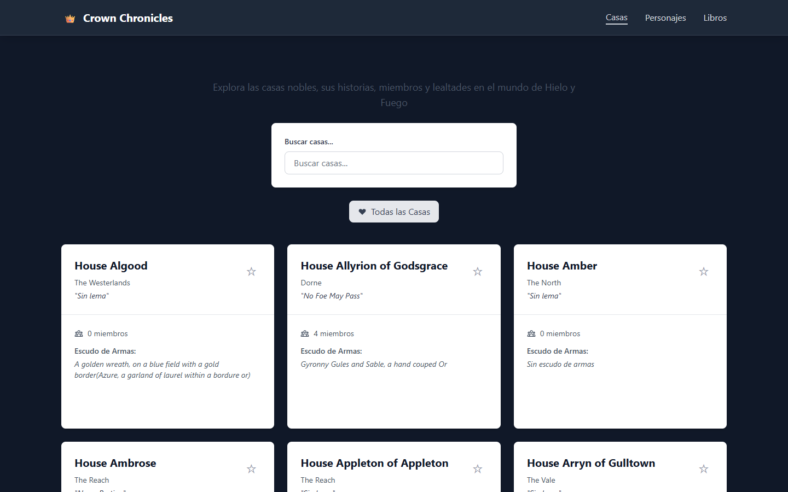
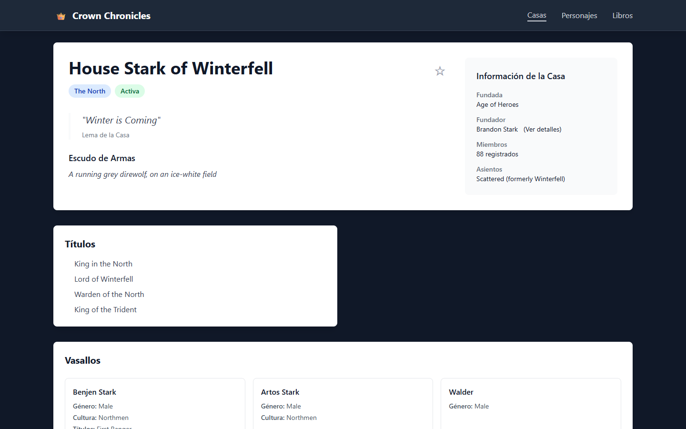
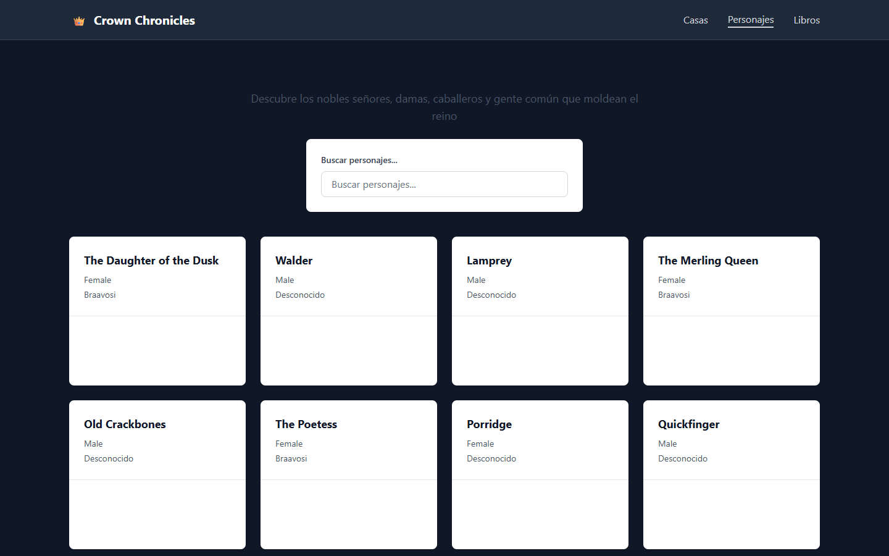
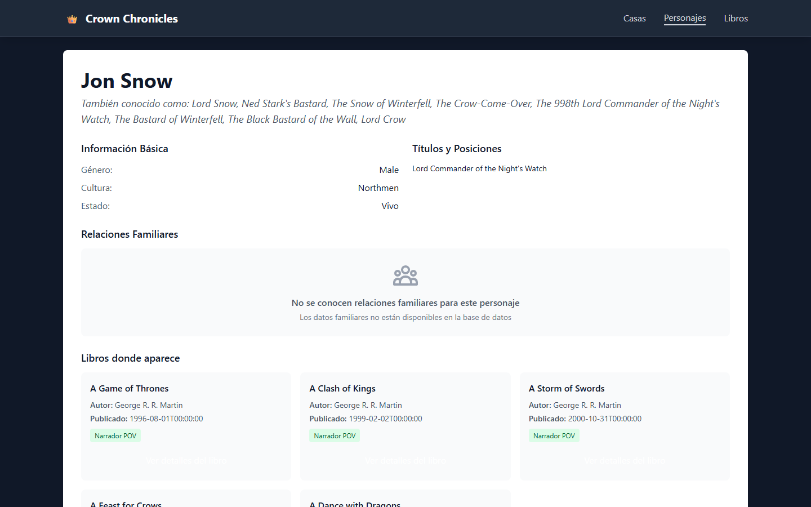
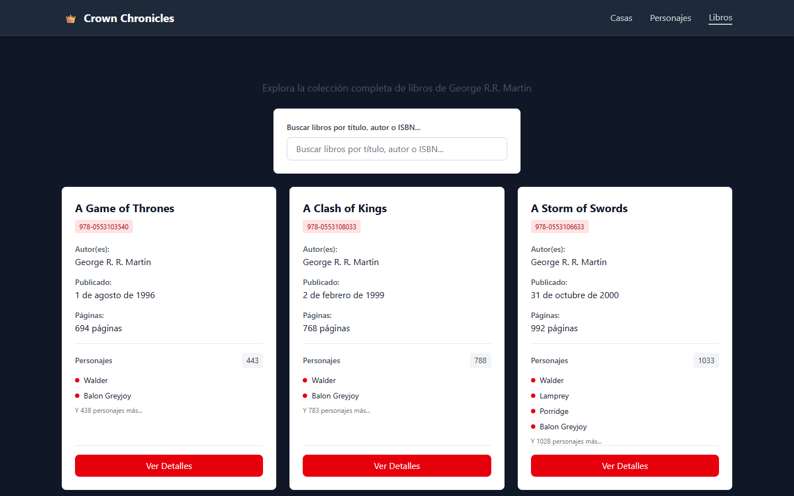
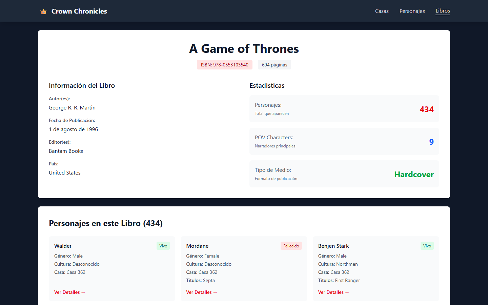

# Crown Chronicles

Angular app to explore Game of Thrones books, houses and characters using a public API.

**Demo:** https://k18tatiana.github.io/Crown-Chronicles/

Aplicación web en Angular para explorar el universo de *Canción de Hielo y Fuego*: casas, personajes y libros, con datos de [An API of Ice and Fire](https://anapioficeandfire.com).



## Contenido

- [Contexto del proyecto](#contexto-del-proyecto)
- [Características](#características)
- [Capturas](#capturas)
- [Uso](#uso)
- [Inicio rápido](#inicio-rápido)
- [Scripts disponibles](#scripts-disponibles)
- [Limitaciones conocidas](#limitaciones-conocidas)
- [Arquitectura](#arquitectura)
- [Configuración](#configuración)
- [Estructura del repositorio](#estructura-del-repositorio)

## Contexto del proyecto

Proyecto académico de la especialización en Desarrollo de Software II. Es una aplicación de una sola página (SPA) que solo consume una API pública; no tiene backend propio ni base de datos.

## Características

### Casas
- Listado con lema, región, número de miembros y escudo de armas, con búsqueda por nombre, región o lema.
- Detalle con fundador (con enlace a su ficha), títulos, asientos y vasallos (miembros de la casa).
- **Favoritos**: se marcan con la estrella, se guardan en el `localStorage` del navegador y se filtran con el botón "Todas las Casas". El filtro se combina con la búsqueda.

### Personajes
- Listado con búsqueda por nombre, cultura o título.
- Detalle con alias, género, cultura, estado, títulos y relaciones familiares (padre, madre y cónyuge) con enlace a cada ficha, cuando la API tiene el dato.
- Libros donde aparece el personaje, indicando si es narrador (POV).

### Libros
- Listado con búsqueda por título, autor o ISBN.
- Detalle con autor, fecha, editorial, país, formato, número de personajes y narradores (POV), y la lista de personajes del libro.

### General
- Paginación en los listados de casas y personajes, y en los personajes de cada libro.
- Caché en memoria de las respuestas de la API (5 minutos en desarrollo, 10 en producción).
- Tema oscuro fijo (la aplicación agrega la clase `dark` al arrancar) e interfaz en español.
- Las cuadrículas usan puntos de quiebre de Tailwind (`md`, `lg`); no he probado la aplicación en móvil.
- La interfaz y el diseño se desarrollaron con asistencia de IA.

## Uso

1. **Casas** (`/#/houses`): busca por nombre, región o lema; usa la estrella para marcar favoritas y "Todas las Casas" para filtrar solo las favoritas; haz clic en una casa para ver su detalle.
2. **Personajes** (`/#/characters`): busca por nombre, cultura o título y abre la ficha de un personaje para ver sus relaciones familiares y los libros donde aparece.
3. **Libros** (`/#/books`): busca por título, autor o ISBN y abre un libro para ver sus personajes.

## Capturas

| Casas | Detalle de una casa |
|---|---|
|  |  |

| Personajes | Detalle de un personaje |
|---|---|
|  |  |

| Libros | Detalle de un libro |
|---|---|
|  |  |

## Inicio rápido

Requisitos: [Node.js](https://nodejs.org/) compatible con Angular 20 (v20.19+ o v22.12+) y conexión a internet, porque los datos vienen de la API pública.

```bash
git clone https://github.com/K18Tatiana/Crown-Chronicles.git
cd Crown-Chronicles
npm install
npm start
```

Después abre **http://localhost:4200**.

> La página de **Personajes** descarga todos los personajes de la API en peticiones de 12 en 12, así que puede tardar unos segundos en mostrar las tarjetas. La búsqueda y la paginación se hacen en el navegador, sobre los datos ya descargados.

## Limitaciones conocidas

- **Cobertura de pruebas mínima.** Solo existe `src/app/app.spec.ts` (3 pruebas del componente raíz: que se crea, que muestra el nombre y que enlaza a Casas, Personajes y Libros). No hay pruebas de servicios, mappers ni de las páginas.
- **El workflow de GitHub Actions solo despliega la demo**: no ejecuta las pruebas.
- Dependen de la disponibilidad de la API pública: si no responde, los listados quedan vacíos.
- Los datos de la API están incompletos en muchos casos (por ejemplo, varias casas sin lema o con 0 miembros, y personajes sin relaciones familiares); la interfaz muestra "Sin lema", "Desconocido" o un mensaje de que no hay datos.
- Los nombres de casas y personajes, y los datos de la API, están en inglés; la interfaz está en español.
- `d3` figura como dependencia, pero el código actual no lo utiliza.
- **El tema personalizado no está definido.** Las plantillas usan clases como `bg-got-red` y `font-got`, pero `src/styles.css` solo importa la fuente Cinzel y Tailwind, sin definirlas, así que esas clases no tienen efecto: no hay acentos rojos ni dorados en la navegación y la fuente Cinzel no se aplica. Además, los subtítulos de cada página (gris oscuro sobre fondo oscuro) se leen con dificultad.

## Scripts disponibles

| Comando | Descripción |
|---|---|
| `npm start` | Servidor de desarrollo con recarga (`ng serve`) en el puerto 4200 |
| `npm run build` | Compila la aplicación a `dist/` |
| `npm run watch` | Compilación continua en modo desarrollo |
| `npm test` | Pruebas con Karma y Jasmine (requiere Chrome). Para ejecutarlas una sola vez: `npx ng test --watch=false --browsers=ChromeHeadless` |

## Arquitectura

```
┌──────────────────────────────┐   HTTP    ┌──────────────────────────┐
│   Angular 20 (SPA, :4200)    │ ────────► │  An API of Ice and Fire  │
│ Páginas → Servicios → Mappers│           │ anapioficeandfire.com    │
└──────────────┬───────────────┘           └──────────────────────────┘
               │
        localStorage (favoritos)
```

| Capa | Descripción |
|---|---|
| `pages/` | Componentes de página (listados y detalles), cargados de forma diferida por ruta |
| `components/` | Componentes reutilizables: tarjetas, búsqueda, paginación, favoritos y spinner |
| `services/` | Acceso a la API con `HttpClient`, señales de Angular y caché en memoria |
| `services/mapper/` | Transforman las respuestas de la API en los modelos de la aplicación |
| `interfaces/` | Tipos de personajes, casas, libros y respuestas |

| Tecnología | Uso |
|---|---|
| Angular 20 | Framework con componentes independientes (*standalone*), enrutamiento con carga diferida (*lazy loading*) y `HttpClient` |
| Angular Signals + RxJS | Estado reactivo en los servicios y peticiones HTTP |
| TypeScript | Modo estricto activado (`strict` y `strictTemplates`) |
| Tailwind CSS 4 | Estilos |
| Karma + Jasmine | Pruebas (ver [Limitaciones conocidas](#limitaciones-conocidas)) |

Patrones usados: los servicios hacen de capa de acceso a datos y los *mappers* transforman las respuestas de la API en los modelos que usa la interfaz.

Las rutas usan *hash* (`/#/houses`, `/#/characters`, `/#/books`) y cada listado tiene su detalle en `/:id`.

## Configuración

La URL de la API y los valores por defecto están en [`src/environments/environment.ts`](src/environments/environment.ts):

| Variable | Valor por defecto | Descripción |
|---|---|---|
| `apiBaseUrl` | `https://anapioficeandfire.com` | URL base de la API |
| `cacheTimeout` | `300000` | Duración de la caché en milisegundos (5 min). En `environment.prod.ts` es `600000` (10 min) |
| `defaultPageSize` | `12` | Elementos por página |

## Estructura del repositorio

```
CrownChronicles/
├── docs/screenshots/        # Capturas usadas en este README
├── public/                  # Recursos estáticos
└── src/
    ├── environments/        # Configuración de desarrollo y producción
    └── app/
        ├── app.routes.ts    # Rutas de la aplicación
        └── ice-and-fire/
            ├── pages/       # houses, characters y books (listado y detalle)
            ├── components/  # book-card, character-card, house-card, search-bar...
            ├── services/    # book, character y house (+ mappers)
            └── interfaces/  # Modelos y tipos
```
